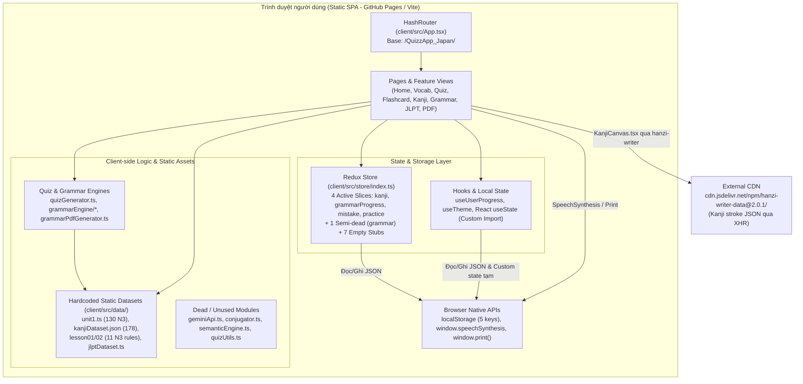

# QUizzApp Japan (Nihongo 問) – FULL PROJECT AUDIT & GAP ANALYSIS

> **Phạm vi & Phương pháp kiểm toán**: Báo cáo **PROJECT DISCOVERY & TECHNICAL AUDIT** (chỉ đọc mã nguồn, cấu hình, dữ liệu, lịch sử Git và chạy kiểm tra tĩnh không phá hủy) trên toàn bộ repository `d:\BAITAP\Quizz_App\Quizz_App_NiHon` (nhánh `develop`, commit gốc `185b881` + các chỉnh sửa UI/CSS chưa commit trong `client/src/`).  
> **Nguyên tắc đánh giá**: Phân loại trạng thái `DONE` / `PARTIAL` / `MOCK` / `MISSING` / `UNKNOWN` hoàn toàn dựa trên mã nguồn thực tế có khả năng thực thi, không đánh giá dựa trên tên thư mục hay ý tưởng.

---

## PHẦN 1 – Executive Summary

- **Công nghệ đang sử dụng**:
  - **Frontend**: React `19.2.8`, TypeScript `~6.0.2`, Vite `8.3.0`, Tailwind CSS v4 (`@tailwindcss/vite` `4.3.3`), React Router DOM `7.18.3` (`HashRouter`), Redux Toolkit `2.12.0` + `react-redux` `9.3.0`, `lucide-react` `1.45.0`, `@hello-pangea/dnd` `18.0.1`, `hanzi-writer` `3.7.3`, `@fontsource/noto-sans-jp` `5.3.0`.
  - **Backend & Database**: **Hiện tại KHÔNG TỒN TẠI trong cây mã nguồn (`HEAD`)**. Lịch sử Git (`a592093d`..`65dd7da0`) cho thấy từng có thư mục `server/` (Express 5 + Prisma 5.22 + SQLite `dev.db`), nhưng đã bị xóa toàn bộ ở commit `52556de` (`16/09/2026`) để chuyển sang mô hình Frontend tĩnh triển khai lên GitHub Pages.
- **Kiến trúc hiện tại**: **100% Static Single Page Application (SPA) Client-side**. Toàn bộ dữ liệu từ vựng, Kanji, ngữ pháp và đề JLPT được đóng gói trực tiếp (bundle) vào mã JavaScript thông qua import TypeScript/JSON tĩnh. Tiến độ học tập và lỗi sai được lưu cục bộ trên từng trình duyệt qua `localStorage` (`5` khóa lưu trữ riêng biệt). Ngoại lệ mạng duy nhất khi chạy thực tế là thư viện `hanzi-writer` tải dữ liệu nét chữ từ CDN `cdn.jsdelivr.net`.
- **Những chức năng đã hoàn thành thực sự (`DONE` ở tầng Client Offline)**:
  - Khung điều hướng SPA (`HashRouter`), giao diện Light/Dark theme đồng bộ biến thiết kế ngữ nghĩa.
  - Học & tra cứu từ vựng N3 Unit 1 (`130` từ), Flashcard lật 3D kèm phát âm Web Speech API, đánh dấu từ yêu thích & thống kê từ sai.
  - Sinh đề & làm Quiz từ vựng trắc nghiệm (chế độ hệ thống N3 Unit 1 hoặc nhập mảng JSON tạm thời).
  - Bảng điều khiển & chi tiết `178` chữ Kanji, luyện viết nét chữ tương tác (`HanziWriter`: Show/Trace/Test), tự động đánh dấu thuộc sau 3 lần viết đúng.
  - Học lý thuyết và luyện tập `11` mẫu ngữ pháp Shin Kanzen Master N3 (2 bài học, `220` câu ví dụ/ngân hàng câu hỏi kèm `StarQuestionComp` kéo-thả/chọn ô ★, và ghi nhận danh sách lỗi sai).
  - Hệ thống luyện thi JLPT (`N5`/`N4`/`N3`) gồm 9 module (Kanji, Từ vựng, Ngữ pháp, Hái sao ★, Đọc hiểu Ngắn/Trung/Dài kèm Furigana, Nghe hiểu dùng giọng đọc trình duyệt, Thi thử Full Test bấm giờ 20 phút).
  - Xuất PDF theo chuẩn in A4 (`window.print()` + `@media print`) cho Từ vựng và Ngữ pháp.
- **Mức độ hoàn thiện tổng quan**:
  - Về **trải nghiệm học thử/cá nhân offline cho N3 (Unit 1 + 2 bài đầu ngữ pháp + 178 Kanji)**: Hoàn thiện tốt ở giao diện và luồng tương tác client.
  - Về **mục tiêu hệ thống hoàn chỉnh đa cấp độ, có tài khoản, đồng bộ tiến độ, Admin CMS & quản lý nội dung**: **Chưa đáp ứng** — hoàn toàn thiếu Backend, Database, xác thực/phân quyền (`SUPER_ADMIN`/`ADMIN`/`USER`), đồng bộ dữ liệu đa thiết bị và dữ liệu học thật cho `N5`, `N4` (từ vựng/ngữ pháp), `N2`, `N1`.
- **Những vấn đề lớn nhất**:
  1. **Không có Backend & Database**: Mọi dữ liệu học bị hardcode trong bundle JS; mọi thao tác nhập JSON (`CustomDataImport.tsx`) chỉ lưu tạm trong React state và **mất sạch khi tải lại trang (F5)**.
  2. **Không có tài khoản & phân quyền**: Không thể đăng ký, đăng nhập, phân quyền Admin, hay chia sẻ/đồng bộ tiến độ học của người dùng ngoài `localStorage` gắn chặt với 1 trình duyệt.
  3. **Chênh lệch nghiêm trọng giữa dữ liệu quảng bá và dữ liệu thật**: `UNIT_DATA` khai báo `810` từ qua 6 unit (`N5`–`N1`), nhưng thực tế chỉ có **`130` từ thuộc `N3 Unit 1`**; Ngữ pháp chỉ có **`11` mẫu N3**; Kanji có `178` chữ với `meanings` tiếng Anh và `hanViet` rỗng `100%`.
  4. **Nhiều bug dữ liệu/logic & tính năng dang dở**: 4 trang placeholder mồ côi (`/vocabulary/writing`, `/vocabulary/review`, `/vocabulary/unmastered`, `/settings`), 7 Redux slice rỗng (`TODO`), bug `validateAnswer` truyền `grammarId` thay vì tên ngữ pháp, lỗi in của `KanjiPdfBuilder`, rủi ro crash ứng dụng nếu dữ liệu `localStorage` (`nihonmaster_kanji_progress` hoặc `nihonmaster_user_progress`) bị sai định dạng, và phụ thuộc CDN bên ngoài khi vẽ nét Kanji.

---

## PHẦN 2 – Current Architecture

Sơ đồ bên dưới chỉ phản ánh các thành phần **đang thực sự tồn tại và hoạt động** trong `client/` ở `HEAD` (cùng nhánh phụ thuộc ngoài `cdn.jsdelivr.net` và Web APIs của trình duyệt). Không vẽ Backend hay Database vì các thành phần này không tồn tại trong cây mã nguồn hiện hành.

---

## PHẦN 3 – Feature Inventory

| Nhóm | Tính năng | Trạng thái | Bằng chứng file / Symbol | Hạn chế hiện tại |
|---|---|---|---|---|
| **Hạ tầng** | Static SPA Routing (`HashRouter`) | `DONE` | `client/src/App.tsx:34-76` | Chưa có route fallback `path="*"` (404). |
| **Hạ tầng** | Giao diện Light / Dark Theme | `DONE` | `client/src/hooks/useTheme.ts`, `client/index.html:17-29`, `client/src/index.css` | `META_COLORS` trong `useTheme.ts:6` lệch màu với `index.html:26`. |
| **Hạ tầng** | Backend API Server | `MISSING` | Đã xóa `server/` ở commit `52556de`; còn sót `client/.env.example` | Không có máy chủ API, không có endpoints runtime. |
| **Hạ tầng** | Database tập trung | `MISSING` | Không có schema/DB runtime; `server/prisma/` chỉ còn trong git log cũ | Toàn bộ dữ liệu nằm tĩnh trong JS bundle & `localStorage`. |
| **Tài khoản** | Đăng ký / Đăng nhập / Session / JWT | `MISSING` | Không có bất kỳ file auth/user/session nào trong `client/src/` | Không phân biệt người dùng, không đồng bộ đa thiết bị. |
| **Phân quyền** | Phân quyền `SUPER_ADMIN` / `ADMIN` / `USER` | `MISSING` | Không có route guard hay role check | Ai truy cập web đều như nhau; không có khu vực Admin. |
| **Từ vựng** | Danh sách theo cấp độ / Unit / Bảng từ | `PARTIAL` | `VocabularyLevelsPage.tsx`, `VocabularyUnitsPage.tsx`, `VocabularyWordsPage.tsx`, `data/index.ts` | Chỉ `N3 Unit 1` có `130` từ; `N5/N4/N3 U2/N2/N1` đều rỗng dù `unitData.ts` liệt kê `810` từ. |
| **Từ vựng** | Đánh dấu sao & đếm số lần làm sai | `PARTIAL` | `client/src/hooks/useUserProgress.ts` (`nihonmaster_user_progress`) | Chỉ hỗ trợ `wordId` dạng `number`; lưu cục bộ trình duyệt và dễ lệch state giữa các component cùng mount. |
| **Từ vựng** | Flashcard 3D lật thẻ + phát âm | `DONE` | `client/src/components/flashcard/FlashcardViewer.tsx` | Không có nút tắt tự động đọc; lỗi phát âm không có thông báo; phụ thuộc dữ liệu `N3 Unit 1`. |
| **Từ vựng** | Quiz trắc nghiệm từ vựng | `PARTIAL` | `QuizPage.tsx`, `QuizSetup.tsx`, `QuizPlay.tsx`, `utils/quizGenerator.ts` | Bỏ sót dạng `vi_to_kanji`; có bug trùng đáp án khi `answer === 1`; UI chưa có bộ chọn `questionType`. |
| **Từ vựng** | Luyện viết / Ôn tập tổng hợp / Từ chưa thuộc | `MOCK` | `WritingPage.tsx`, `ReviewPage.tsx`, `UnmasteredPage.tsx` | Chỉ render `<EmptyState>` placeholder; không có link nào trong app trỏ tới. |
| **Kanji** | Bảng tra cứu `178` Kanji & chi tiết | `PARTIAL` | `KanjiDashboard.tsx`, `KanjiDetail.tsx`, `kanjiDataset.json` | Rút trích từ N3 Unit 1; thiếu `100%` âm Hán Việt (`hanViet: ""`); nghĩa tiếng Anh; chữ `会` bị rỗng dữ liệu. |
| **Kanji** | Luyện viết nét chữ tương tác (`HanziWriter`) | `PARTIAL` | `KanjiCanvas.tsx`, `KanjiPractice.tsx`, `kanjiSlice.ts` | Tải JSON nét chữ tiếng Trung từ CDN ngoài (`jsdelivr`), hỏng khi offline; không bắt lỗi fetch CDN; lỗi có thể crash nếu `localStorage` hỏng. |
| **Ngữ pháp** | Giáo trình, bài giảng & ví dụ động | `PARTIAL` | `GrammarDashboard.tsx`, `GrammarDetail.tsx`, `GrammarLesson.tsx`, `grammar/index.ts` | Chỉ có **11 mẫu N3** (2 bài học); `N5/N4/N2/N1` trống; `grammarSlice.ts` không được dispatch. |
| **Ngữ pháp** | Luyện tập & chấm đáp án ngữ pháp | `PARTIAL` | `GrammarPractice.tsx`, `lesson01PracticeBank.ts`, `questionGenerator.ts`, `answerValidator.ts` | `GrammarPractice` kẹt loading vô tận nếu URL sai; `validateAnswer` nhận nhầm `grammarId` thay vì tên mẫu câu; bỏ qua mode `conjugation`/`vi_to_ja` khi có bank tĩnh. |
| **Ngữ pháp** | Lưu & ôn tập lỗi sai (Grammar + JLPT) | `DONE` | `MistakesReview.tsx`, `mistakeSlice.ts` (`nihonmaster_grammar_mistakes`) | Chỉ lưu ở `localStorage`; câu sinh động có seed `Date.now()` dễ trùng bản ghi lỗi. |
| **JLPT** | Luyện thi 9 module JLPT | `PARTIAL` | `JLPTModulePage.tsx`, `jlptDataset.ts`, `JlptReadingView.tsx`, `JlptFullTestView.tsx`, `AudioSpeechPlayer.tsx` | Chỉ hỗ trợ `N5`, `N4`, `N3` (thiếu `N2/N1`); phần Nghe dùng Web Speech API không có file audio; Kanji MCQ sinh tự động bị lặp từ vựng (`生年月日` x3). |
| **PDF** | Xuất PDF Từ vựng & Ngữ pháp | `PARTIAL` | `PdfPage.tsx`, `VocabularyPdfWorkspace.tsx`, `GrammarPdfWorkspace.tsx` | Dùng `@media print` (`window.print()`), không tạo file `.pdf` trực tiếp (`@react-pdf/renderer` cài sẵn nhưng không dùng). |
| **PDF** | Xuất PDF Kanji | `PARTIAL` | `KanjiPdfWorkspace.tsx`, `KanjiPdfBuilder.tsx` | Không dùng portal / thiếu `#root { display: none }` & `print:hidden` trên header → dính giao diện web khi in; thiếu nạp `MPLUS1p`. |
| **PDF** | Xuất PDF Flashcard | `MISSING` | `PdfPage.tsx:50-58` | Tab hiển thị `<EmptyState title="Đang phát triển" />`. |
| **Admin/CMS** | Quản lý nội dung Admin & CRUD DB | `MISSING` | Không tồn tại trang/chức năng Admin | Mọi thay đổi nội dung phải sửa code TS/JSON và build/deploy lại. |
| **Admin/CMS** | Nhập JSON tạm từ người dùng | `PARTIAL` | `CustomDataImport.tsx` | Chỉ parse mảng JSON paste tay vào state tạm của Quiz/PDF Từ vựng; mất khi F5; không hỗ trợ CSV, preview hay validate trường bắt buộc. |
| **AI** | Trích xuất từ vựng bằng Gemini AI | `MOCK` / `DEAD` | `client/src/utils/geminiApi.ts` | Hàm có tồn tại nhưng **không được import ở đâu**, chỉ copy prompt tay trong `CustomDataImport.tsx`. |
| **Cài đặt** | Trang Cài đặt | `MOCK` | `client/src/pages/SettingsPage.tsx` | Chỉ render placeholder `"This is the placeholder for SettingsPage."`, không có đường dẫn tới. |

---

## PHẦN 4 – Frontend Audit

### 4.1. Công nghệ & Phiên bản (`client/package.json`)
- **Framework**: `react` `^19.2.8`, `react-dom` `^19.2.8`, TypeScript `~6.0.2`.
- **Bundler & CSS**: `vite` `^8.3.0`, `@vitejs/plugin-react` `^6.1.1`, `tailwindcss` `^4.3.3`, `@tailwindcss/vite` `^4.3.3`.
- **Routing & State**: `react-router-dom` `^7.18.3` (`HashRouter`), `@reduxjs/toolkit` `^2.12.0`, `react-redux` `^9.3.0`.
- **Thư viện chuyên biệt**: `hanzi-writer` `^3.7.3` (vẽ Kanji), `@hello-pangea/dnd` `^18.0.1` (kéo-thả cột PDF), `lucide-react` `^1.45.0`, `@fontsource/noto-sans-jp` `^5.3.0`, `@fontsource/roboto` `^5.3.0` *(không được import sử dụng)*.
- **Thư viện cài thừa chưa dùng trong code**: `@react-pdf/renderer` `^4.9.0`, `@embedpdf/fonts-jp` `^1.0.0`, `@google/genai` `^2.22.0`, `@google/generative-ai` `^0.24.1` (chỉ import trong dead file `geminiApi.ts`), `@types/jest` `^30.0.0` (không có runtime test).

### 4.2. Cấu trúc thư mục (`client/src/`)
- `components/ui/`: Hệ thống design primitives chuẩn hóa (`Button`, `Fields`, `Layout`, `Feedback`, `Overlays`, `Tabs`, `ThemeToggle`, `Toast`, `styles.ts`).
- `components/layout/`: `AppLayout.tsx`, `JapaneseLandscapeBg.tsx`, `ClickEffect.tsx`.
- `components/quiz/`, `components/practice/`, `components/jlpt/`, `components/kanji/`, `components/flashcard/`, `components/pdf/workspaces/`, `components/common/`: Phân tách theo domain feature khá gọn gàng; tuy nhiên vẫn còn component rời ở root `components/` (`AnswerOption.tsx`, `Explanation.tsx`, `Hint.tsx`, `ProgressBar.tsx`, `QuestionCard.tsx`, `QuizHeader.tsx`, `QuizNavigation.tsx`, `QuizResult.tsx`) và một số file mồ côi (`VocabularyTabs.tsx`, `GrammarCard.tsx`, `ExportPDFModal.tsx`).
- `data/`, `store/`, `hooks/`, `types/`, `utils/`, `config/`, `scripts/`: Tổ chức rõ ràng về mặt tên thư mục, nhưng lớp `data/` import phân mảnh trực tiếp ở nhiều nơi thay vì qua 1 API/data facade thống nhất.

### 4.3. Bảng chi tiết từng trang & Route (`client/src/App.tsx`)

| Trang (Component & Đường dẫn) | Route | Đã triển khai | Chức năng thực tế | Vấn đề |
|---|---|---|---|---|
| `HomePage` (`pages/HomePage.tsx`) | `/` | Có | Hiển thị tóm tắt tiến độ từ Redux (`kanji.progress`, `grammarProgress.records`, `mistake.mistakes`), điều hướng 6 mục học chính và 9 module JLPT. | Thiếu đường dẫn tới `/settings`, `/vocabulary/writing`, `/vocabulary/review`, `/vocabulary/unmastered`; số tổng `/178` Kanji & `/11` Ngữ pháp tính trên tập dữ liệu tĩnh hiện có nhưng `grammarPracticed` không lọc các ID cũ nếu dữ liệu đổi. |
| `VocabularyLevelsPage` (`pages/vocabulary/VocabularyLevelsPage.tsx`) | `/vocabulary` & `/flashcard` | Có | Hiển thị 5 cấp độ N5–N1. | N5, N4, N2, N1 đều dẫn vào unit rỗng. |
| `VocabularyUnitsPage` (`pages/vocabulary/VocabularyUnitsPage.tsx`) | `/vocabulary/:level` & `/flashcard/:level` | Có | Liệt kê Unit theo `UNIT_DATA`, kiểm tra số lượng hiển thị. | `UNIT_DATA` khai báo `totalWords` giả định (100–200 từ) cho các unit chưa có dữ liệu (`N5`, `N4`, `N3 Unit 2`, `N2`, `N1`), gây hiểu nhầm cho người học. |
| `VocabularyWordsPage` (`pages/vocabulary/VocabularyWordsPage.tsx`) | `/vocabulary/:level/:unitId` | Có | Tìm kiếm (Kanji/Kana/Hán Việt/Nghĩa), lọc từ loại, phát âm TTS, đánh dấu sao & xem số lần sai (`useUserProgress`). | Từ chỉ có kana (`id: 54, 62, 78, 89`) lưu kana vào trường `kanji`, khiến giao diện hiển thị lặp chữ kana 2 lần. |
| `QuizPage` (`pages/QuizPage.tsx`) | `/vocabulary/quiz` | Có | Điều phối giữa `QuizSetup` và `QuizPlay`. | Không lưu lịch sử phiên làm bài sau khi thoát. |
| `WritingPage` (`pages/WritingPage.tsx`) | `/vocabulary/writing` | Placeholder | Chỉ hiển thị `<EmptyState description="This is the placeholder for WritingPage." />`. | Không có logic luyện viết từ vựng; route mồ côi không có link truy cập. |
| `ReviewPage` (`pages/ReviewPage.tsx`) | `/vocabulary/review` | Placeholder | Chỉ hiển thị `<EmptyState description="This is the placeholder for ReviewPage." />`. | Không có logic ôn tập SRS; route mồ côi. |
| `UnmasteredPage` (`pages/UnmasteredPage.tsx`) | `/vocabulary/unmastered` | Placeholder | Chỉ hiển thị `<EmptyState description="This is the placeholder for UnmasteredPage." />`. | Route mồ côi. |
| `FlashcardPage` + `FlashcardViewer` (`pages/FlashcardPage.tsx`, `components/flashcard/FlashcardViewer.tsx`) | `/flashcard/*` | Có | `<Outlet />` điều hướng tới `FlashcardViewer`: lật thẻ 3D, phím tắt (`Space`/`Arrow`/`Enter`), xáo trộn, đánh dấu sao, tự động đọc TTS. | Không có công tắc tắt tự động đọc; không dọn `speechSynthesis.cancel()` khi unmount; không chặn `SpeechSynthesisUtterance` nếu trình duyệt thiếu hỗ trợ. |
| `KanjiDashboard` (`pages/kanji/KanjiDashboard.tsx`) | `/kanji` | Có | Lưới `178` Kanji, thanh tiến độ thuộc, tìm kiếm (Kanji/Hán Việt/nghĩa/ON-KUN), lọc N5–N1. | Hầu hết `hanViet` rỗng & `meanings` tiếng Anh nên tìm tiếng Việt ít ra kết quả; dữ liệu lấy từ N3 Unit 1. |
| `KanjiDetail` (`pages/kanji/KanjiDetail.tsx`) | `/kanji/:kanjiId` | Có | Hiển thị thông tin Kanji, ví dụ từ `unit1Data`, nút đánh dấu đã thuộc, nút luyện viết, link Quiz lọc `?kanji=`. | Chữ `会` có `strokeCount: 0` dẫn tới in số `0` lạc lõng trong JSX (`{kanji.strokeCount && ...}`); link Quiz sẽ báo lỗi nếu chữ Kanji không nằm trong N3 Unit 1 (hiện đều từ Unit 1 nhưng sẽ lỗi nếu thêm Kanji ngoài). |
| `KanjiPractice` (`pages/kanji/KanjiPractice.tsx`) | `/kanji/:kanjiId/practice` | Có | Luyện vẽ qua `KanjiCanvas` (`show`/`trace`/`test`), hướng dẫn lần đầu (`Modal`), lưu số lần thử/đúng và tự động thuộc sau 3 lần đúng. | Tải dữ liệu nét chữ từ `cdn.jsdelivr.net` (tiếng Trung, hỏng khi offline); `KanjiCanvas` ẩn spinner sau `500ms` cố định kể cả khi fetch CDN thất bại. |
| `GrammarDashboard` (`pages/grammar/GrammarDashboard.tsx`) | `/grammar` | Có | Accordion danh sách bài học từ `grammarBooks` (1 sách N3, 2 bài), lọc N5–N1. | N5, N4, N2, N1 không có bài học; `grammarSlice` trong Redux không được sử dụng tại đây. |
| `GrammarDetail` (`pages/grammar/GrammarDetail.tsx`) | `/grammar/:bookId/:chapterId` | Có | Liệt kê mẫu câu trong bài kèm điểm cao nhất từ `grammarProgress`, link xem bài giảng & luyện tập cả bài. | Nếu `score` lần làm sau thấp hơn lần trước, `updateProgress` ghi đè điểm cao cũ thành điểm thấp. |
| `GrammarLesson` (`pages/grammar/GrammarLesson.tsx`) | `/grammar/:bookId/:chapterId/lesson/:grammarId` | Có | Lý thuyết cấu trúc, ghi chú, 3 ví dụ từ `generateSmartQuestionSet` + phân tích token câu, đổi ví dụ khác. | `generateSmartQuestionSet` bỏ qua tham số `unit1Data` được truyền vào, chỉ xoay vòng 20 câu cứng trong `lesson01Sentences`/`lesson02Sentences`. |
| `GrammarPractice` (`pages/grammar/GrammarPractice.tsx`) | `/grammar/:bookId/:chapterId/practice(/:grammarId)` | Có | Luyện nhiều dạng câu (MCQ, Điền khuyết, Ghép câu, Hái sao ★, Tự luận), ghi lỗi vào `mistakeSlice`, lưu điểm vào `grammarProgress`. | **Bug 1**: URL sai `bookId`/`grammarId` gây kẹt `<LoadingState />` vô tận. **Bug 2**: Khi chọn mode `conjugation`/`vi_to_ja`/`ja_to_vi`, bank tĩnh `DEFAULT_MIXED_TYPES` không có các loại này nên fallback trả lại 20 câu mixed thay vì sinh đúng mode. **Bug 3**: Truyền `question.grammarId` (VD `N3-SKZ-L01-UCHINI-01`) thay cho cấu trúc ngữ pháp vào `validateAnswer`. |
| `MistakesReview` (`pages/grammar/MistakesReview.tsx`) | `/grammar/mistakes` | Có | Nhóm các lỗi sai đã lưu từ Grammar & JLPT theo chuyên mục, xem giải thích, xóa từng nhóm / xóa tất cả, nút `"Luyện lại"`. | `state.grammar.availableRules` (fallback tra cứu) luôn là `[]`; các câu luyện động sinh trùng câu với `seed = Date.now()` tạo nhiều bản ghi lỗi trùng lặp cho cùng 1 câu. |
| `JLPTModulePage` (`pages/jlpt/JLPTModulePage.tsx`) | `/jlpt/:moduleId` | Có | Điều phối 9 module JLPT (`kanji`, `vocab`, `grammar`, `star`, `reading-short/medium/long`, `listening`, `full-test`), lọc N5/N4/N3, ghi lỗi sai. | Không có N2/N1; bài Nghe dùng TTS trình duyệt; Kanji MCQ sinh từ `kanjiDataset.json` bị trùng 7/18 từ ví dụ (`生年月日` 3 câu); Đọc hiểu dài N4/N5 thiếu Furigana segments. |
| `PdfPage` (`pages/PdfPage.tsx`) | `/pdf` | Một phần | Tabs chuyển đổi 4 workspace (`vocabulary`, `grammar`, `kanji`, `flashcard`). | Tab `flashcard` chỉ là placeholder `"Đang phát triển"`; `KanjiPdfBuilder` in ra cả header/tabs của app vì thiếu `print:hidden` và `createPortal`. |
| `SettingsPage` (`pages/SettingsPage.tsx`) | `/settings` | Placeholder | Chỉ render `<EmptyState title="Trang cài đặt" description="This is the placeholder for SettingsPage." />`. | Không có chức năng cài đặt thực tế; route mồ côi. |

### 4.4. Component dùng chung (`client/src/components/ui/`)
- Bộ primitives hoàn chỉnh & sạch token (`Button`, `IconButton`, `buttonStyles`, `Field`, `Input`, `Textarea`, `Select`, `SearchInput`, `Switch`, `Checkbox`, `Chip`, `Card`, `CardLink`, `Badge`, `PageContainer`, `Breadcrumbs`, `PageHeader`, `Kbd`, `Stat`, `ProgressBar`, `Tooltip`, `LoadingState`, `Skeleton`, `EmptyState`, `ErrorState`, `Notice`, `Modal`, `DropdownMenu`, `Tabs`, `ThemeToggle`, `Toast`).
- **Tình trạng dư thừa**: `Skeleton` và `SkeletonList` (`Feedback.tsx:83-105`) được định nghĩa nhưng không trang nào sử dụng.

### 4.5. State Management
- **Redux Store (`client/src/store/index.ts`)** gồm **12 slices**, thực trạng phân bố rất mất cân đối:
  - **3 slice hoạt động + lưu `localStorage`**: `kanjiSlice.ts`, `grammarProgressSlice.ts`, `mistakeSlice.ts`.
  - **1 slice hoạt động chỉ trong RAM**: `practiceSlice.ts`.
  - **1 slice bán-chết**: `grammarSlice.ts` (khai báo `availableRules` đọc tại `MistakesReview.tsx:28` nhưng **không có bất kỳ `dispatch` nào** tới `setGrammarRules`, `setSelectedLevel`, `selectGrammar` trong toàn app).
  - **7 slice rỗng hoàn toàn (`// TODO`)**: `appSlice.ts`, `vocabularySlice.ts`, `quizSlice.ts`, `flashcardSlice.ts`, `learningSlice.ts`, `reviewSlice.ts`, `writingSlice.ts`.
- **Hooks & Local React State**: `useUserProgress.ts` quản lý từ đánh dấu sao & từ sai độc lập bằng `useState` riêng ở mỗi nơi gọi (thay vì Redux), dẫn đến thiếu đồng bộ tức thời nếu 2 component cùng mount; `CustomDataImport` chỉ truyền dữ liệu về `useState` cục bộ của `QuizSetup` / `VocabularyPdfWorkspace`.

### 4.6. API Service & Xử lý lỗi
- **Không có API service layer**. Không tồn tại bất kỳ lời gọi `fetch`, `axios`, hay `REST/GraphQL` client nào kết nối tới Backend của dự án trong `client/src/`.
- File `client/src/utils/geminiApi.ts` chứa gọi `@google/generative-ai` trực tiếp từ client nhưng là **dead code** không được import.
- **Xử lý lỗi (Error Handling)**: Chưa có **React ErrorBoundary** toàn app tại `main.tsx` hay `App.tsx`; `JLPTModulePage` và `QuizPlay` có dùng `<ErrorState>`; `kanjiSlice.ts` gọi `localStorage.setItem` trực tiếp trong reducer mà không có `try/catch` (nếu đầy bộ nhớ hoặc duyệt web chế độ riêng tư chặn storage sẽ văng uncaught exception).

### 4.7. Authentication ở phía Frontend
- **MISSING hoàn toàn**: Không có màn hình đăng nhập/đăng ký, không có token storage, không có auth context/slice, không có protected route.

### 4.8. Responsive trên Desktop & Mobile
- Giao diện sử dụng hệ lưới chuẩn của Tailwind (`sm:`, `md:`, `lg:`), chuyển đổi tốt giữa desktop và mobile (`VocabularyWordsPage` tách card view trên `<md` và table trên `>=md`; `JlptReadingView` tách 2 cột `lg:col-span-7/5`; kiểm thử headless Chrome thực tế tại `1440×900` và `390×844` cho `scrollWidth === innerWidth = 390`).
- Hạn chế nhỏ: `KanjiCanvas.tsx:138` cố định inline `width: 300px, height: 300px` (ổn trên màn >=340px nhưng thiếu co giãn linh hoạt cho màn rất nhỏ <=320px), và kéo-thả HTML5 trong `StarQuestionComp` chỉ tối ưu cho chuột desktop (mobile dựa vào thao tác chạm chọn từng mảnh ghép).

### 4.9. Loading, Empty State, Error State
- **Empty State**: Triển khai khá tốt trên phần lớn trang (`<EmptyState>` trong Vocabulary, Kanji, Grammar, JLPT, Flashcard, MistakesReview), ngoại trừ `QuizPlay.tsx:226-228` trả về `null` nếu mảng câu hỏi rỗng.
- **Loading State**: Dùng cho sinh quiz/PDF và vẽ Kanji, nhưng `GrammarPractice.tsx:218` bị lỗi treo `<LoadingState />` mãi mãi khi URL sai tham số, và `KanjiCanvas.tsx:92` tắt spinner theo `setTimeout(500ms)` mù bất kể request CDN tải xong hay lỗi.
- **Error State**: Thiếu Error Boundary toàn cục; lỗi tải dữ liệu Kanji CDN bị nuốt im lặng (`Blank Canvas`).

### 4.10. Giao diện Client & Admin
- Toàn bộ giao diện hiện tại thuộc về **Client học tập**. **Chưa có bất kỳ trang hay route nào dành cho Admin** (`/admin`, quản lý từ vựng, quản lý bài học, phân quyền người dùng).

---

## PHẦN 5 – Backend & API Audit

### 5.1. Tình trạng thực tế ở `HEAD`
- **Backend Framework & Module**: **MISSING (Không tồn tại)** trong cây mã nguồn hiện hành (`develop`, `main`).
- **Lịch sử Git đối chiếu**: Ở commit `a592093d`..`65dd7da0`, tác giả từng khởi tạo thư mục `server/` sử dụng `express ^5.2.1`, `prisma ^5.22.0`, `sqlite3 ^6.0.1`, `cors ^2.8.6`, `dotenv ^17.4.2`, chạy tại cổng `3001` (`VITE_API_URL=http://localhost:3001` trong `client/.env.example`), với duy nhất 1 endpoint `POST /api/quiz/session`. Tuy nhiên toàn bộ `server/` đã bị **xóa bỏ** tại commit `52556de` (`16/09/2026`), và mọi tính năng (Quiz, Grammar, PDF) đã chuyển sang đọc dữ liệu tĩnh ngay tại `client/` (commit `0cc6b84`).
- **Kiểm tra cấu phần còn lại**: Không có Controller, Service, Repository, DTO, Validation middleware, Auth/JWT, Logging framework, CORS config hay Swagger/OpenAPI docs nào tồn tại ở runtime hiện nay.

### 5.2. Bảng Endpoint Audit

| Module | Endpoint | Method | Chức năng | Trạng thái | Ghi chú / Bằng chứng |
|---|---|---|---|---|---|
| Vocabulary / Quiz | `/api/quiz/session` | `POST` | Từng sinh phiên quiz từ SQLite (`server/src/index.ts`) | **Đã bị xóa (`MISSING`)** | Chỉ tồn tại trong lịch sử git cũ (`<= 65dd7da0`); frontend không còn gọi, `client/.env.example` vẫn còn biến `VITE_API_URL=http://localhost:3001` không được tham chiếu. |
| AI Extract (Third-party) | Google Gemini API (`gemini-2.0-flash`) | SDK HTTP | Trích xuất từ vựng tiếng Nhật qua `@google/generative-ai` | **Có code nhưng chưa dùng (`MOCK`/Dead)** | Định nghĩa tại `client/src/utils/geminiApi.ts:3`, không được import ở bất kỳ màn hình nào. |
| Kanji Stroke Data (Third-party CDN) | `https://cdn.jsdelivr.net/npm/hanzi-writer-data@2.0.1/{char}.json` | `GET` | Tải dữ liệu nét viết Kanji runtime | **Hoạt động (Bên thứ 3)** | Gọi tự động bởi `hanzi-writer` trong `client/src/components/kanji/KanjiCanvas.tsx:73-88`; rủi ro phụ thuộc CDN ngoài và dùng bộ dữ liệu chữ Hán giản thể/phồn thể gốc Trung Quốc. |
| Auth / Users / Admin / Progress / Curriculum | Mọi endpoint (`/api/auth/*`, `/api/admin/*`, `/api/vocab/*`, `/api/progress/*`...) | `-` | Xác thực, phân quyền, CRUD nội dung, đồng bộ tiến độ | **Chưa tìm thấy (`MISSING`)** | Hoàn toàn chưa có backend. |

---

## PHẦN 6 – Database Audit

### 6.1. Hiện trạng Database & Trả lời 6 câu hỏi trọng tâm

1. **Dữ liệu hiện tại được lưu ở đâu?**
   - **Dữ liệu học tập hệ thống**: Đóng gói tĩnh dưới dạng file TypeScript và JSON ngay trong `client/src/data/`.
   - **Dữ liệu tiến độ người học**: Lưu cục bộ trên trình duyệt của người dùng qua `window.localStorage` (`5` key: `theme`, `nihonmaster_user_progress`, `nihonmaster_kanji_progress`, `nihonmaster_grammar_progress`, `nihonmaster_grammar_mistakes`).
   - **Dữ liệu người dùng nhập tay (`CustomDataImport`)**: Chỉ giữ tạm trong bộ nhớ RAM của React (`useState`), không ghi xuống ổ đĩa hay DB.
2. **Có đang hardcode JSON/TS trong Frontend không?**
   - **Có, 100%**. Cụ thể: `client/src/data/n3/unit1.ts` (`130` từ), `kanjiDataset.json` (`178` Kanji), `lesson01.ts` + `lesson02.ts` (`11` mẫu ngữ pháp), `lesson01Sentences.ts` + `lesson02Sentences.ts` (`220` câu), `lesson01PracticeBank.ts` (`220` câu luyện), `jlptDataset.ts` (các bộ đề N5/N4/N3).
3. **Dữ liệu có được lấy từ API không?**
   - **Không**. Chỉ riêng nét bút Kanji của `HanziWriter` là fetch JSON tĩnh từ CDN `cdn.jsdelivr.net`.
4. **Admin có thể thay đổi dữ liệu mà không cần build/deploy lại Frontend không?**
   - **Không**. Vì dữ liệu được import tĩnh vào Vite bundle tại build-time, mọi bổ sung/chỉnh sửa dữ liệu hệ thống đều bắt buộc sửa source code, chạy `npm run build` và deploy lại.
5. **Khi thêm một bài học mới, cần thao tác ở đâu?**
   - **Từ vựng**: Tạo file dữ liệu mới trong `client/src/data/<level>/unitX.ts`, đăng ký vào `allVocabularyData` (`client/src/data/index.ts`), khai báo metadata trong `UNIT_DATA` (`client/src/data/unitData.ts`), rồi chạy lại `client/scripts/extractKanji.js` (và dịch tay nghĩa + Hán Việt nếu muốn chuẩn tiếng Việt), rồi rebuild & deploy.
   - **Ngữ pháp**: Thêm rule vào `lessonXX.ts`, thêm vào `grammarBooks` (`client/src/data/grammar/index.ts`), thêm câu vào `*Sentences.ts`, cập nhật `GRAMMAR_POOL`/`RULE_SYNONYM_EXCLUSIONS` trong `questionTypes.ts` và chạy `generateBanks.ts`, rồi rebuild & deploy.
   - **JLPT**: Sửa/thêm trực tiếp trong `client/src/data/jlpt/jlptDataset.ts` rồi rebuild & deploy.
6. **Có nguy cơ mất dữ liệu khi cập nhật ứng dụng không?**
   - **Có nhiều nguy cơ cao**:
     - Nếu người dùng đổi trình duyệt, xóa cache/site data, dùng chế độ ẩn danh, hoặc chuyển từ tên miền cũ sang tên miền mới (Origin khác) → **Mất toàn bộ tiến độ `localStorage`**.
     - Khi cập nhật app nếu đổi `id` bài học/từ vựng/ngữ pháp (như hiện tượng không nhất quán giữa `N3-SKZ-L01-*` và `N3_L02_*`, hoặc giữa `unit1.ts` ID `1..130` với các unit tương lai nếu đánh số lại từ `1`) → Tiến độ cũ và mới sẽ **xung đột hoặc mồ côi vĩnh viễn**.
     - Không có cơ chế versioning/migration cho `localStorage` → Thay đổi cấu trúc JSON trong bản update mới có thể làm crash app khi `JSON.parse` (đặc biệt ở `kanjiSlice.ts` và `useUserProgress.ts` không kiểm tra cấu trúc sau parse).

### 6.2. Kiểm tra cấu trúc dữ liệu học tiếng Nhật & Đối chiếu Schema

* *(Ghi chú lịch sử: Trong commit cũ đã bị xóa `65dd7da0:server/prisma/schema.prisma`, DB cũ chỉ mới có 4 bảng sơ khai `Book`, `Unit`, `Word`, `LearningProgress` dùng SQLite cho từ vựng, chưa có bảng User, Kanji, Grammar, JLPT, QuizAttempt.)*

| Thực thể / Bảng | Trạng thái hiện tại trong code | Cấu trúc thực tế & Độ lệch / Khoảng trống |
|---|---|---|
| **Vocabulary** | `PARTIAL` (Hardcode TS) | **Không có TypeScript `Vocabulary` interface chuẩn**. Trong `unit1.ts` (`130` mục) thậm chí tồn tại **2 cấu trúc khác nhau**: IDs `1..120` có `{ id, unitId, wordNumber, kanji, hiragana, hanViet, meaning, exampleSentence: null, exampleMeaning: null, notes: null, wordType }`; IDs `200..209` bỏ 3 trường null và thêm `{ tags, semanticRoles }`. Đối chiếu schema tham khảo `{kanji, hiragana, hanViet, meaning, wordType}`: trùng với prompt ở `CustomDataImport.tsx:14`, nhưng `geminiApi.ts:6` lại thiếu `wordType`, `unit1.ts` dùng chuỗi tiếng Việt (`'Danh từ'`, `'Động từ'`, `'Tính từ -na'`, `'Tính từ đuôi i'`) trong khi `types/quiz.ts` định nghĩa enum tiếng Anh (`'noun'`, `'verb'`, `'na_adj'`, `'i_adj'`). |
| **Kanji** | `PARTIAL` (Hardcode JSON) | `KanjiItem` (`types/kanji.ts`) trong `kanjiDataset.json` (`178` mục): **178/178 mục rỗng `hanViet: ""`**, `meanings` hoàn toàn bằng **tiếng Anh**, `strokeOrder`/`radical`/`components` đều vắng mặt, và Kanji `会` bị rỗng dữ liệu. |
| **Grammar** | `PARTIAL` (Hardcode TS) | `SmartGrammarRule` (`types/grammarEngine.ts`) mới có **11 mục N3**; dữ liệu `grammar/n4.ts` (`3` rule cũ) và `scenarios/` bị bỏ hoang không dùng. |
| **Lessons** | `PARTIAL` (Hardcode TS) | `UNIT_DATA` khai báo 6 unit từ vựng (`810` từ) nhưng 5 unit rỗng; `grammarBooks` mới có 1 sách N3 với 2 chapter. |
| **Quiz / Questions / Answers / Explanations** | `PARTIAL` (In-memory / Hardcode) | `Vocabulary` quiz sinh động bởi `quizGenerator.ts` (không lưu DB); `Grammar` lưu sẵn 220 câu trong `lesson01PracticeBank.ts`; `JLPT` gom tĩnh trong `jlptDataset.ts` (33 Kanji, 28 Vocab, 32 Grammar, 28 Star, 9 bài Đọc hiểu = 17 câu, 6 Nghe hiểu). |
| **Categories / JLPT Levels** | `PARTIAL` | `JLPTLevel = 'N5' \| 'N4' \| 'N3' \| 'N2' \| 'N1'`, nhưng dữ liệu thật chỉ tập trung ở N3 (Từ vựng, Ngữ pháp) và N5/N4/N3 (JLPT); không có phân loại Category/Tag động trên DB. |
| **User Progress** | `PARTIAL` (`localStorage`) | Tách rời thành 3 key không đồng bộ schema (`nihonmaster_user_progress`, `nihonmaster_kanji_progress`, `nihonmaster_grammar_progress`). Không gắn với User ID. |
| **Quiz Attempts** | `MISSING` | Không lưu lịch sử các lần làm bài, điểm số theo thời gian hay thời gian làm bài. `MistakesReview` chỉ lưu các câu làm sai gần nhất tại `nihonmaster_grammar_mistakes`. |
| **Bookmarks / Favorites** | `PARTIAL` (`localStorage`) | Chỉ có `starredWords: number[]` trong `useUserProgress.ts` (chỉ áp dụng cho từ vựng hệ thống có ID số; không có bookmark cho Kanji, Ngữ pháp hoặc từ custom). |

---

## PHẦN 7 – Authentication & Authorization Audit

### 7.1. Hiện trạng trong Repository
- **Đăng ký / Đăng nhập / Đăng xuất**: `MISSING`
- **JWT / Session / Refresh Token**: `MISSING`
- **Quản lý thông tin người dùng / Lưu tiến độ theo tài khoản**: `MISSING`
- **Phân quyền & Bảo vệ API / Route**: `MISSING`
- **Biến môi trường liên quan**: Chỉ tìm thấy file mẫu `client/.env.example` chứa biến `VITE_API_URL` (không được sử dụng trong source code). Không phát hiện file `.env` chứa secret/password/key thật nào bị commit trong workspace hay `client/`.

### 7.2. Đánh giá khả năng & Kiến trúc triển khai mô hình phân quyền (`SUPER_ADMIN` / `ADMIN` / `USER`)
Vì dự án hiện **chưa có Backend và Database**, **tuyệt đối không thể triển khai phân quyền an toàn chỉ bằng Frontend** (nhất là khi host trên GitHub Pages vốn phục vụ file tĩnh công khai, mọi code JS và thông tin kiểm tra quyền ở client đều có thể bị người dùng mở DevTools chỉnh sửa).

Để hỗ trợ an toàn 3 cấp quyền như mục tiêu:
- **`SUPER_ADMIN`**: Quản lý tài khoản Admin (tạo/cấp/thu hồi quyền `ADMIN`), quản lý toàn bộ nội dung và người dùng; cần ràng buộc ở tầng Backend (cấm tự hạ quyền bản thân nếu là `SUPER_ADMIN` cuối cùng, cấm `ADMIN` thường sửa/xóa tài khoản có `role = SUPER_ADMIN`).
- **`ADMIN`**: Toàn quyền CRUD + Import/Export nội dung học tập (Từ vựng, Kanji, Ngữ pháp, Bài học, JLPT); bị chặn tuyệt đối ở tầng Backend mọi API sửa cột `role` hoặc quản lý tài khoản Admin.
- **`USER`**: Đọc nội dung học công khai, ghi tiến độ học/lịch sử làm bài/bookmark gắn với `req.user.id` từ JWT (chống IDOR: user A không bao giờ đọc/sửa được tiến độ của user B).

**Checklist bảo mật bắt buộc phải kiểm soát khi xây dựng**:
1. **Không bao giờ tin `role` hoặc `userId` gửi từ Client**: Chỉ lấy `userId` và `role` từ Access Token (JWT ký ở Backend bằng secret mạnh hoặc từ session xác thực server-side).
2. **Bảo vệ chống leo thang đặc quyền (Privilege Escalation)**: DTO đăng ký / cập nhật hồ sơ cá nhân phải whitelist trường hợp lệ, loại bỏ hoàn toàn trường `role` khỏi request body đăng ký công khai.
3. **Không ẩn nút suông ở Frontend**: Mọi endpoint `/api/admin/*` phải qua middleware `requireAuth` + `requireRole('ADMIN', 'SUPER_ADMIN')`, và `/api/super-admin/*` phải qua `requireRole('SUPER_ADMIN')`.
4. **Không lộ Secret trên GitHub Pages**: Biến `VITE_*` của Vite được nhúng công khai vào bundle JS trình duyệt — **tuyệt đối không đặt** DB URI, JWT Secret, Gemini API Key hệ thống hoặc Service Role Key vào biến `VITE_*` hay code `client/`.

---

## PHẦN 8 – Admin & Content Management Audit

### 8.1. Kiểm tra năng lực Admin hiện tại
- Hệ thống **chưa có giao diện Admin**, chưa có cơ chế ghi dữ liệu vào Database, và chưa có quản trị người dùng.
- Chức năng gần nhất với nhập nội dung hiện chỉ là component **[CustomDataImport.tsx](file:///d:/BAITAP/Quizz_App/Quizz_App_NiHon/client/src/components/common/CustomDataImport.tsx)** được nhúng trong tab *"Tùy chỉnh"* của `QuizSetup.tsx` và `VocabularyPdfWorkspace.tsx` (dành cho người học tự dán từ vựng dùng tạm).

| Chức năng quản lý nội dung | Trạng thái | Bằng chứng thực tế / Đánh giá |
|---|---|---|
| Thêm / Sửa / Xóa dữ liệu thủ công (CRUD) | `MISSING` | Không có form tạo/sửa/xóa Từ vựng, Kanji, Ngữ pháp, Bài học, Câu hỏi. |
| Xem danh sách Admin / Phân trang | `MISSING` | Danh sách học ở Client render toàn bộ mảng tĩnh (`130` từ, `178` Kanji) trong 1 trang, không có phân trang. |
| Tìm kiếm & lọc (ở Client học tập) | `DONE` (Client) | Có ở `VocabularyWordsPage` và `KanjiDashboard` trên dữ liệu tĩnh, chưa có cho Admin CRUD. |
| Paste JSON | `PARTIAL` | Có trong `CustomDataImport.tsx:86-94`, nhưng chỉ nhận mảng từ vựng và **lưu tạm trong React state** (mất khi F5). |
| Import file `.json` / `.csv` | `MISSING` | Không có `<input type="file">` chọn file `.json` hay parser `.csv`. |
| Preview dữ liệu trước khi nhập | `MISSING` | `CustomDataImport.tsx` ghi đè state ngay khi bấm `"Nhập dữ liệu"`, không có bảng xem trước. |
| Kiểm tra dữ liệu không hợp lệ | `PARTIAL` | Chỉ kiểm tra `JSON.parse()` và `Array.isArray()`. Nếu mảng chứa `[null, 123, {}]`, hàm `.map` tự biến thành `{ id: "V..." }` rỗng ruột (`CustomDataImport.tsx:41-46`) mà không báo lỗi. |
| Phát hiện bản ghi trùng lặp | `MISSING` | Không kiểm tra trùng `(kanji, hiragana)` hay trùng `id`. |
| Export JSON (backup nội dung) | `MISSING` | Không có tính năng xuất bộ dữ liệu hệ thống hoặc dữ liệu tự nhập ra JSON. |
| Quản lý nhiều cấp độ JLPT / Bài học / Bộ câu hỏi | `MISSING` | Các cấp độ N5/N4/N2/N1 và Unit mới chỉ chỉnh được bằng cách sửa code và build lại. |
| Chế độ Import JSON nâng cao (Insert Only, Upsert, Validate toàn bộ trước khi ghi, Batch, Báo cáo thành công/thất bại, Rollback) | `MISSING` | Không khả dụng vì chưa có Database, transaction hay API batch import. |

> **Kết luận**: Hiện tại Admin **KHÔNG THỂ** quản lý hay cập nhật dữ liệu thật vào Database. Mọi thao tác nhập JSON trong `CustomDataImport` chỉ có tác dụng tạm thời ở Frontend cho phiên làm quiz/in PDF hiện tại.

---

## PHẦN 9 – Learning Experience Audit

| Tính năng | Có giao diện | Có logic | Có lưu dữ liệu | Đánh giá |
|---|---|---|---|---|
| **Danh sách từ vựng** | Có (`VocabularyWordsPage.tsx`) | Có (tìm kiếm, lọc từ loại, phát âm TTS) | Không (chỉ đọc `unit1.ts`) | **PARTIAL**: Đầy đủ UI/UX cho Unit 1 N3, thiếu dữ liệu cho mọi unit/cấp độ khác. |
| **Chi tiết từ vựng** | Có (hiển thị dạng dòng/card trong danh sách + hint quiz) | Có | Không | **PARTIAL**: Không có trang/modal chi tiết riêng; các trường `exampleSentence`, `exampleMeaning`, `notes` trong `unit1.ts` đều `null`/rỗng. |
| **Luyện tập trắc nghiệm (Từ vựng)** | Có (`QuizSetup.tsx`, `QuizPlay.tsx`) | Có (`quizGenerator.ts`) | Có phần sai (`addWrongWord` vào `localStorage`) | **PARTIAL**: Chạy tốt với từ vựng hệ thống (N3 U1) & JSON tự dán; thiếu `vi_to_kanji`, có bug map đáp án JSON sẵn và bỏ qua từ sai của dữ liệu custom. |
| **Hiển thị đáp án đúng và sai** | Có (`AnswerOption.tsx`, `McqQuestionBlock.tsx`, `GrammarPractice.tsx`) | Có | Không | **DONE**: Phản hồi trực quan rõ ràng bằng màu sắc ngữ nghĩa + icon. |
| **Giải thích đáp án** | Có (`Explanation.tsx`, `McqQuestionBlock.tsx`) | Có | Không | **DONE**: Hiển thị đầy đủ Kanji/Hiragana/Hán Việt/Nghĩa hoặc giải thích ngữ pháp/JLPT ngay sau khi chọn. |
| **Luyện tập theo JLPT (`N5/N4/N3`)** | Có (`JLPTModulePage.tsx`, `JlptReadingView.tsx`, `JlptFullTestView.tsx`) | Có | Chỉ lưu câu sai (`mistakeSlice`) | **PARTIAL**: 9 module chạy trơn tru cho N5/N4/N3, nhưng **vắng N2/N1**, phần Nghe dùng TTS trình duyệt không có file audio, và 18 câu Kanji sinh từ dataset bị trùng từ ví dụ. |
| **Luyện tập theo bài học (Ngữ pháp & Unit)** | Có (`GrammarDetail`, `GrammarLesson`, `GrammarPractice`, `VocabularyUnitsPage`) | Có | Có (`grammarProgressSlice`) | **PARTIAL**: Mới có 1 Unit Từ vựng N3 và 2 Bài học Ngữ pháp N3 (11 mẫu câu); `GrammarPractice` có bug treo loading khi URL sai và ghi đè điểm cao cũ. |
| **Lưu từ vựng yêu thích (Bookmark)** | Có (nút ngôi sao trên Từ vựng & Flashcard) | Có (`toggleStar`) | Có (`localStorage` `nihonmaster_user_progress`) | **PARTIAL**: Chỉ hỗ trợ từ vựng N3 Unit 1 (`wordId` dạng số); chưa có cho Kanji, Ngữ pháp hay từ custom; dễ lệch giữa các component do dùng hook state cục bộ. |
| **Lịch sử làm bài** | Không (chỉ xem lại *câu làm sai* ở `MistakesReview`) | Thiếu | Không | **MISSING**: Không lưu lại các phiên đã làm, điểm lịch sử theo ngày, hay bài đã hoàn thành chi tiết theo thời gian. |
| **Tiến độ học tập** | Có (`HomePage`, `KanjiDashboard`, `GrammarDetail`) | Có | Có (`localStorage`) | **PARTIAL**: Chỉ đếm số Kanji đã thuộc (`/178`), Ngữ pháp đã luyện (`/11`) và số lỗi sai ở trình duyệt hiện tại; các mục `ReviewPage`/`UnmasteredPage` mới là placeholder. |
| **Thống kê kết quả** | Có trong cuối phiên (`QuizResult.tsx`, màn kết thúc Grammar/JLPT) | Có | Không lưu lịch sử tổng | **PARTIAL**: Chỉ thống kê đúng/sai/% ngay tại phiên hiện tại, thoát ra là mất. |
| **Flashcard 3D** | Có (`FlashcardViewer.tsx`) | Có | Chỉ lưu nút sao | **DONE (trên N3 U1)**: Hỗ trợ bàn phím đầy đủ, hoạt ảnh 3D mượt, phát âm tự động. |
| **Luyện viết Kanji (`HanziWriter`)** | Có (`KanjiCanvas.tsx`, `KanjiPractice.tsx`) | Có | Có (`nihonmaster_kanji_progress`) | **PARTIAL**: Chạy tốt khi có mạng truy cập jsDelivr; hỏng khi offline và dùng nét chữ dữ liệu Hán tự Trung Quốc thay vì KanjiVG Nhật. |
| **Xuất tài liệu học PDF (Print)** | Có (`PdfPage.tsx`) | Có (Từ vựng, Ngữ pháp, Kanji) | Không | **PARTIAL**: Dùng `@media print`; tab Flashcard chưa làm; Kanji PDF bị lỗi in dính giao diện app. |
| **Responsive trên điện thoại** | Có | Có | Không liên quan | **DONE**: Tương thích mobile `390×844` sạch sẽ (`0` tràn ngang), riêng kéo-thả Mondai ★ vẫn có phương án bấm chạm thay thế. |

---

## PHẦN 10 – Deployment & CI/CD Audit

- **GitHub Pages & Base URL Routing**:
  - `client/vite.config.ts:8` thiết lập `base: '/QuizzApp_Japan/'`.
  - `client/src/App.tsx:34` dùng `HashRouter` → URL thực tế dạng `https://duy18nd.github.io/QuizzApp_Japan/#/vocabulary/quiz` hoạt động chính xác trên static hosting GitHub Pages mà không cần cấu hình fallback 404 server-side.
- **GitHub Actions CI/CD (`.github/workflows/deploy.yml`)**:
  - Trigger tự động khi `push` vào nhánh **`main`** hoặc chạy tay `workflow_dispatch`.
  - Chạy trên `ubuntu-latest`, Node.js `20`, thực thi `npm ci` và `npm run build` trong `./client`, sau đó upload `./client/dist` qua `actions/deploy-pages@v4`.
  - *Lưu ý nhánh Git*: Hiện workspace đang đứng ở nhánh **`develop`** (nhiều chỉnh sửa giao diện gần nhất đang chưa commit trên `develop`), trong khi CI/CD chỉ theo dõi nhánh **`main`**. Ngoài ra trong repo gốc `package.json` vẫn còn bộ script thủ công cũ (`"deploy": "gh-pages -d client/dist"`, `"git:push": "git add . && git commit ... && git push -u origin main"`).
- **Backend Hosting & Database Hosting**: **MISSING**. Không có file cấu hình Docker, Procfile, Render/Railway/Fly.io/VPS config hay chuỗi kết nối Database nào.
- **Biến môi trường (`.env`) & CORS**:
  - Chỉ có `client/.env.example` (`VITE_API_URL=http://localhost:3001`), không được đọc ở bất kỳ file nào.
  - Không có cấu hình CORS vì không có Backend.
- **Domain & SSL/HTTPS**: Đang sử dụng domain mặc định GitHub Pages (`duy18nd.github.io`) có sẵn HTTPS.
- **Phân định trạng thái vận hành thực tế**:
  - **Đang chạy thực tế (Production static)**: Toàn bộ Frontend SPA (`client/dist`) phục vụ miễn phí trên GitHub Pages từ nhánh `main` (hoặc `gh-pages`).
  - **Chỉ chạy local / script rời**: `client/scripts/extractKanji.js` (cào `kanjiapi.dev`), `client/src/scripts/generateBanks.ts` (tái tạo bank ngữ pháp), và các script rác `debug.js`, `debug.ts`, `client/test_quiz.ts`.
  - **Chưa có hosting**: Toàn bộ Backend API, Database tập trung, hệ thống Auth/Admin.
  - **Không phụ thuộc vào máy cá nhân** đối với người dùng cuối khi học phần dữ liệu tĩnh hiện tại; nhưng **phụ thuộc hoàn toàn vào máy developer + Git push** mỗi khi muốn cập nhật bất kỳ từ vựng hay bài học nào, và **phụ thuộc vào CDN `cdn.jsdelivr.net`** cho tính năng vẽ nét Kanji.

---

## PHẦN 11 – Security & Code Quality Audit

### 11.1. Bảo mật
- **Secret hardcode**: Không tìm thấy API key, JWT secret hay DB credentials nào hardcode trong mã nguồn hay `.env` committed. (`geminiApi.ts` nhận `apiKey` làm tham số, và hiện không được dùng).
- **Xác thực & Phân quyền API / Bảo vệ dữ liệu người dùng**: **MISSING** (chưa có Backend/API; `localStorage` hoàn toàn không được bảo vệ giữa các người dùng dùng chung thiết bị hoặc bị sửa trực tiếp qua DevTools).
- **Input Validation**:
  - Tầng UI (`CustomDataImport.tsx`): Kiểm tra rất sơ sài (`JSON.parse` + `Array.isArray`), cho phép mảng rỗng thuộc tính trôi xuống `quizGenerator.ts`.
  - `grammarProgressSlice.ts` có kiểm tra chặn key prototype pollution (`__proto__`, `constructor`, `prototype`); ngược lại `kanjiSlice.ts` và `useUserProgress.ts` **không** có kiểm tra định dạng đối tượng sau `JSON.parse()`.
- **SQL Injection & XSS**:
  - SQL Injection: Không áp dụng hiện tại do chưa có Database/Backend.
  - XSS: Kiểm tra toàn bộ `client/src/` cho kết quả **0** vị trí dùng `dangerouslySetInnerHTML`, `innerHTML`, `document.write` hay `eval()` (ngoại trừ script build-time `client/scripts/extractKanji.js:24` dùng `new Function` đọc file local `unit1.ts`). Các `<style>` trong PDF builders dùng chuỗi hằng tĩnh. Nguy cơ XSS hiện tại ở mức **Thấp**.
- **CORS**: Chưa tồn tại vì chưa có Backend. (Lịch sử `server/` cũ dùng `app.use(cors())` mở hoàn toàn `*` — cần lưu ý cấu hình whitelist origin chặt chẽ khi xây Backend mới).
- **Lộ thông tin trong Log**: Không lộ secret, nhưng `App.tsx:28` + `fontManager.ts` + `useUserProgress.ts` in `console.log`/`console.warn`/`console.error` trực tiếp ra console trình duyệt ở production.

### 11.2. Chất lượng Code & Công cụ kiểm tra
- **TypeScript & Linter**:
  - Kiểm tra trực tiếp trên workspace hiện tại: `npx tsc --noEmit` đạt `exit code 0`; `npx oxlint` đạt `0 warnings, 0 errors` trên `127 files`.
  - Dù pass `tsc`, nhiều file vẫn lạm dụng kiểu **`any`** (`data/index.ts:3`, `types/quiz.ts:30`, `types/grammar.ts:68,72`, `quizGenerator.ts:67,112`, `geminiApi.ts:3`).
  - Lỗi cú pháp nhỏ về mặt ngữ nghĩa type ở `client/src/types/grammar.ts:18-20`: `export type GrammarCategory = | 'conjugation'` bị cắt ngang ngay trước `export interface TransformationRule`.
- **Unit Test / Integration Test**:
  - **Không có test runner** (`jest` / `vitest`) và không có script `"test"` trong `package.json` dù trong `client/devDependencies` có cài `@types/jest` và có 1 file test bỏ không là `client/src/utils/grammarEngine/__tests__/conjugator.test.ts`.
- **Hiệu năng đóng gói (Bundle Size)**:
  - `npm run build` hiện sinh file JS chính dung lượng **`1,197.57 kB`** (`287.97 kB` gzip) kèm cảnh báo vượt ngưỡng `500 kB` của Vite do toàn bộ dữ liệu (`lesson01PracticeBank.ts` ~339KB, `kanjiDataset.json` ~103KB, `jlptDataset.ts` ~91KB...) và các trang được import đồng bộ, chưa chia chunk (`React.lazy`).
- **Tài liệu hướng dẫn chạy dự án**:
  - `README.md` ở gốc repository vẫn là file mẫu mặc định *"React + TypeScript + Vite"* của template ban đầu, **không hề hướng dẫn** cấu trúc dự án, cách chạy dev/build, quy trình nhập dữ liệu hay kiến trúc Deploy. `DESIGN.md` mô tả rất chi tiết token CSS nhưng phần component nền trong `DESIGN.md:43-46` (`<JapaneseWaveBg />`) đã lỗi thời so với `JapaneseLandscapeBg.tsx`.
- **Rác kỹ thuật & Dead Code**:
  - File rác ở root & client: `debug.js`, `debug.ts`, `client/test_quiz.ts`.
  - Code chết trong `client/src/`: `geminiApi.ts`, `quizUtils.ts`, `VocabularyTabs.tsx`, `GrammarCard.tsx`, `ExportPDFModal.tsx`, `grammar/n4.ts`, `grammar/scenarios/*`, `grammarEngine/{conjugator.ts, sentenceGenerator.ts, semanticEngine.ts, vocabularyAdapter.ts, sentenceTemplates.ts}`, 7 empty Redux slices, cùng các package thừa (`@react-pdf/renderer`, `@embedpdf/fonts-jp`, `@google/genai`, `@google/generative-ai`).

---

## PHẦN 12 – Missing Features

Để đạt trọn vẹn các mục tiêu dự án (học đầy đủ cấp độ, chia sẻ cộng đồng, lưu tiến độ theo người dùng, Admin CMS nhập liệu & phân quyền an toàn, chi phí thấp/miễn phí), hệ thống hiện còn thiếu:

1. **Tầng Backend REST API** tách biệt để phục vụ dữ liệu động, xác thực, phân quyền và quản lý nội dung mà không phải rebuild Frontend.
2. **Database quan hệ có cấu trúc chuẩn** cho toàn bộ thực thể: `users`, `refresh_tokens`/sessions, `levels`, `lessons`/`units`, `vocabularies`, `kanjis`, `grammar_rules`, `grammar_sentences`, `jlpt_questions`, `reading_passages`, `user_progress`, `quiz_attempts`, `bookmarks`, `mistakes`, `audit_logs`.
3. **Hệ thống Tài khoản & Phân quyền (`SUPER_ADMIN`, `ADMIN`, `USER`)**: Đăng ký, đăng nhập, bảo mật mật khẩu (`bcrypt`/`argon2`), JWT + Refresh Token, đổi/reset mật khẩu, trang quản trị tài khoản Admin cho `SUPER_ADMIN`.
4. **Cổng Quản trị Admin Dashboard (`/admin`)**:
   - CRUD đầy đủ cho Từ vựng, Kanji, Ngữ pháp, Bài học, JLPT.
   - Công cụ Import JSON/CSV chuyên nghiệp: xem trước dạng bảng (preview), kiểm tra schema chi tiết từng dòng, phát hiện trùng lặp, chọn chế độ **Insert Only / Upsert**, ghi theo batch/transaction có rollback khi lỗi, báo cáo kết quả chi tiết từng dòng lỗi.
   - Export JSON toàn phần hoặc theo từng bài học/cấp độ để sao lưu.
5. **Dữ liệu học tập thực tế cho các cấp độ còn thiếu**: Từ vựng `N5`, `N4`, `N3 Unit 2+`, `N2`, `N1`; Ngữ pháp `N5`, `N4`, `N2`, `N1`; Kanji âm Hán Việt & nghĩa tiếng Việt đầy đủ; JLPT `N2/N1` và file âm thanh nghe thật (thay thế hoặc bổ sung cho Web Speech API).
6. **Hoàn thiện các tính năng học tập bị bỏ trống**:
   - `WritingPage` (luyện gõ nghĩa/kana từ vựng), `ReviewPage` (ôn tập SRS / Spaced Repetition), `UnmasteredPage` (danh sách từ yếu), `SettingsPage` (cài đặt giọng đọc, tốc độ, xóa/xuất dữ liệu cá nhân, đồng bộ tài khoản).
   - Lưu lịch sử làm bài (`Quiz Attempts`) và thống kê tiến bộ theo thời gian thực.
   - Flashcard PDF export & sửa lỗi in của Kanji PDF.
7. **Automated Testing & Chất lượng sản phẩm**: Thiết lập `Vitest` (unit test cho `quizGenerator`, `grammarEngine`, `answerValidator`), Error Boundary toàn cục, Code Splitting (`React.lazy`) và lưu dữ liệu nét viết Kanji cục bộ (KanjiVG hoặc bundle JSON không phụ thuộc hoàn toàn CDN jsDelivr).

---

## PHẦN 13 – Technical Risks

| Mức độ | Rủi ro | Dẫn chứng thực tế | Hệ quả |
|---|---|---|---|
| **Cao** | **Mất toàn bộ dữ liệu học khi đổi thiết bị / xóa cache / đổi domain** | `localStorage` keys (`useUserProgress.ts`, `kanjiSlice.ts`, `grammarProgressSlice.ts`, `mistakeSlice.ts`); `CustomDataImport` chỉ lưu RAM | Người học mất sạch tiến độ, từ sai, bộ từ đã import nếu đổi trình duyệt hoặc F5. |
| **Cao** | **Crash trắng trang khi dữ liệu `localStorage` bị sai cấu trúc hoặc đầy bộ nhớ** | `kanjiSlice.ts:23` (`JSON.parse` không kiểm tra shape); `kanjiSlice.ts:42,69,85,99` (`setItem` không bọc `try/catch`); `useUserProgress.ts:15` | Chỉ cần `localStorage` lưu `"null"` hoặc `{}` là `HomePage`/`KanjiDashboard` văng `TypeError` sập toàn bộ app do thiếu `ErrorBoundary`. |
| **Cao** | **Mất dữ liệu & xung đột tiến độ khi thêm bài học / đổi ID** | `unit1.ts` đánh `id` từ `1..130` rồi nhảy `200..209`; `lesson01.ts` (`N3-SKZ-L01-*`) vs `lesson02.ts` (`N3_L02_*`); `HomePage` đếm tổng chia trên `/178` & `/11` | Nếu thêm Unit 2 mà ID trùng `1..130` thì `useUserProgress` sẽ gộp nhầm sao & lỗi sai giữa hai bài. |
| **Cao** | **Tính năng luyện viết Kanji hỏng hoàn toàn khi offline hoặc CDN lỗi, sai nét chuẩn Nhật** | `KanjiCanvas.tsx:73-88` không cấu hình `charDataLoader`, phụ thuộc `cdn.jsdelivr.net/npm/hanzi-writer-data@2.0.1` (bộ dữ liệu tiếng Trung) | Kẹt/trống khung vẽ không báo lỗi khi mất mạng; sai khác một số nét Shinjitai Nhật Bản. |
| **Trung bình** | **Bug logic chấm điểm & sinh đề làm giảm độ tin cậy học tập** | `GrammarPractice.tsx:218` (treo vô tận khi URL sai); `MultipleChoiceQuestion`/`TextEntryQuestion` truyền `grammarId` vào `validateAnswer`; `quizGenerator.ts:171` (bug so sánh `i+1` với `answer === 1`); `quizGenerator.ts:11` (thiếu `vi_to_kanji`) | Người dùng nhận phản hồi chấm bài sai ngữ cảnh hoặc sinh câu hỏi trùng đáp án/thiếu lựa chọn với bộ từ nhỏ. |
| **Trung bình** | **Rủi ro bảo mật nếu nối API/Admin vội vàng lên mô hình hiện tại** | Nhánh `vite` tự động công khai mọi biến `VITE_*` ra client bundle; chưa có Backend verify JWT/RBAC | Nguy cơ lộ secret/DB key nếu nhúng vào FE, hoặc người dùng tự sửa state/API để chiếm quyền Admin nếu không enforce ở Backend. |
| **Trung bình** | **Bundle JS quá lớn (`1.2 MB`) làm chậm tải lần đầu trên 3G/Mobile** | `npm run build` cảnh báo chunk chính `1,197.57 kB` do gộp tĩnh toàn bộ ngân hàng câu hỏi & route | Nếu thêm dữ liệu N5–N1 vào thẳng JS tĩnh mà không tách sang Backend API hoặc lazy chunk, kích thước bundle sẽ phình to nhiều MB khiến GitHub Pages tải rất chậm. |
| **Thấp–TB** | **In PDF Kanji lỗi giao diện & không ổn định trên các trình duyệt** | `KanjiPdfBuilder.tsx` không dùng Portal/hide `#root`; `AppLayout` thiếu `print:hidden`; `KanjiPdfWorkspace:44` đóng trạng thái render theo `setTimeout(500)` | Bản in Kanji bị dính thanh nav web/tabs và dễ rỗng nội dung nếu hộp thoại in đóng/mở bất đồng bộ. |

---

## PHẦN 14 – Recommended Roadmap

> **Định hướng kiến trúc chi phí thấp / miễn phí ưu tiên**: Giữ nguyên Frontend Static React + Vite miễn phí trên **GitHub Pages**, bổ sung một **Backend API độc lập nhẹ** (VD: Node.js/Express hoặc Fastify + TypeScript — phù hợp với stack sẵn có của tác giả, hoặc Spring Boot nếu team chọn Java) deploy trên **Render / Fly.io / Railway (Free/Starter tier)** kết nối tới một **Database Postgres / MySQL miễn phí hoặc chi phí thấp** (Neon / Supabase Postgres thuần chỉ dùng làm DB / Turso / TiDB / MySQL cloud, có kết nối chuẩn qua ORM như Prisma hoặc Drizzle), lưu file âm thanh/ảnh tĩnh (nếu cần) qua GitHub/Cloudflare R2 Free tier.

### Phase 1 – Critical (Ổn định Frontend & Vá lỗi nghiêm trọng trước khi mở rộng)

1. **Thêm ErrorBoundary toàn cục & gia cố `localStorage` (`kanjiSlice`, `useUserProgress`, `grammarProgressSlice`, `mistakeSlice`)**
   - **Lý do**: Ngăn app sập trắng màn hình khi `localStorage` lỗi/hỏng định dạng hoặc hết dung lượng ở Safari/mobile.
   - **File bị ảnh hưởng**: `client/src/main.tsx`, `client/src/store/slices/kanjiSlice.ts`, `grammarProgressSlice.ts`, `mistakeSlice.ts`, `client/src/hooks/useUserProgress.ts`.
   - **Ưu tiên**: Khẩn cấp (`P0`).
   - **Phụ thuộc**: Không.
   - **Rủi ro**: Cần khéo léo migrate dữ liệu cũ (giữ nguyên key `nihonmaster_*` kèm bước validate shape, fallback mặc định an toàn thay vì xóa tiến độ cũ của người dùng đang học).

2. **Sửa các bug logic lõi trong Quiz, Grammar Practice, Kanji PDF & Route 404**
   - **Lý do**: Đảm bảo mọi chức năng hiện có chạy đúng kết quả (không treo loading, không báo lỗi `targetGrammar` bằng ID, không in dính UI web vào Kanji PDF, không kẹt trang trắng ở URL sai).
   - **File bị ảnh hưởng**: `client/src/App.tsx`, `client/src/pages/grammar/GrammarPractice.tsx`, `client/src/utils/quizGenerator.ts`, `client/src/components/practice/{MultipleChoiceQuestion,TextEntryQuestion,WordOrderQuestion}.tsx`, `client/src/components/pdf/workspaces/{KanjiPdfWorkspace,KanjiPdfBuilder}.tsx`, `client/src/components/layout/AppLayout.tsx`, `client/src/pages/PdfPage.tsx`, `client/src/data/unitData.ts` (đánh dấu rõ trạng thái "Sắp ra mắt" thay vì hiển thị `totalWords` giả cho unit rỗng).
   - **Ưu tiên**: Cao (`P0`).
   - **Phụ thuộc**: Không.
   - **Rủi ro**: Cần test kỹ `generateQuizSession` với cả 2 nguồn (dữ liệu hệ thống và dữ liệu JSON custom có/không có sẵn `quiz[]`).

3. **Dọn dẹp mã chết, thiết lập `Vitest` và cập nhật `README.md`**
   - **Lý do**: Loại bỏ nhầm lẫn giữa code thật và dead code (`7` stub slices, `geminiApi.ts`, `GrammarCard.tsx`, `VocabularyTabs.tsx`, `debug.*`), có test tự động bảo vệ trước khi nối API.
   - **File bị ảnh hưởng**: `client/package.json`, `client/src/store/slices/*`, `client/src/utils/geminiApi.ts`, `README.md`, `client/.env.example`.
   - **Ưu tiên**: Trung bình-Cao (`P1`).
   - **Phụ thuộc**: Không.
   - **Rủi ro**: Cần kiểm tra kỹ các import ẩn trước khi xóa file dead code.

### Phase 2 – Core Features (Khởi tạo Backend, Database, Auth/RBAC & Admin CMS)

1. **Xây dựng Backend API & Database Schema chuẩn (Từ vựng, Kanji, Ngữ pháp, JLPT, User, Progress)**
   - **Lý do**: Giải quyết nút thắt lớn nhất là dữ liệu bị khóa cứng trong bundle JS và tiến độ không lưu lâu dài theo tài khoản. Chuẩn hóa schema từ vựng thống nhất (khớp `{kanji, hiragana, hanViet, meaning, wordType}` + trường mở rộng `exampleSentence`, `exampleMeaning`, `level`, `unitId`, `slug`/`uniqueKey`).
   - **File/Module mới & bị ảnh hưởng**: Khởi tạo lại thư mục `server/` (hoặc service BE tách biệt) + lớp `client/src/services/api.ts`, giữ chiến lược **Offline fallback / Cache** để app vẫn đọc mượt hoặc chuyển dần từng module từ `client/src/data/` sang API.
   - **Ưu tiên**: Cao (`P0`).
   - **Phụ thuộc**: Quyết định của chủ dự án về stack Backend & Database hosting miễn phí.
   - **Rủi ro**: Thay đổi cách load dữ liệu đồng bộ (`sync` import) sang bất đồng bộ (`async` fetch + loading/error state trên các trang).

2. **Triển khai Authentication & RBAC 3 cấp (`SUPER_ADMIN`, `ADMIN`, `USER`)**
   - **Lý do**: Cho phép cộng đồng đăng ký học tập an toàn, đồng bộ tiến độ đa thiết bị, và bảo vệ tuyệt đối thao tác thêm/sửa dữ liệu hệ thống.
   - **File/Module liên quan**: Backend auth (`register`, `login`, `refresh`, `logout`, `me`), middleware `requireAuth` + `requireRole`, Frontend auth context/Redux slice + trang Login/Register + bảo vệ route `/admin`.
   - **Ưu tiên**: Cao (`P0`).
   - **Phụ thuộc**: Database User + Backend API.
   - **Rủi ro**: Rủi ro leo thang đặc quyền hoặc lộ CSRF/XSS token nếu lưu Refresh Token sai cách (nên ưu tiên `HttpOnly` cookie hoặc short-lived Access Token kèm strict CORS whitelist đúng origin GitHub Pages và localhost).

3. **Xây dựng Admin Content Management & Bộ công cụ Import/Export JSON an toàn**
   - **Lý do**: Giúp Admin nhập liệu hàng trăm/ngàn từ vựng N5–N1, ngữ pháp, Kanji và đề JLPT nhanh chóng không cần sửa code/deploy lại FE.
   - **Tính năng cần có**: CRUD theo cấp độ & bài học; Import JSON/CSV hỗ trợ bảng Preview, kiểm tra hợp lệ toàn bộ bằng schema validator (Zod/Joi), phát hiện trùng lặp, lựa chọn **Insert Only** hoặc **Upsert**, chạy transaction **Rollback toàn batch khi có lỗi hoặc báo cáo chi tiết từng dòng lỗi**, Export JSON để backup.
   - **Ưu tiên**: Cao (`P1`).
   - **Phụ thuộc**: Backend API + Auth RBAC (`ADMIN`/`SUPER_ADMIN`).
   - **Rủi ro**: Dữ liệu import JSON từ AI hoặc bên ngoài không đồng nhất (như trường hợp `hanViet`, `wordType`, kana thuần); cần bộ chuẩn hóa & preview bắt buộc trước khi commit vào DB.

4. **Đồng bộ & Migrate dữ liệu `localStorage` lên tài khoản (`User Progress`, `Quiz Attempts`, `Bookmarks`)**
   - **Lý do**: Người học hiện tại khi tạo tài khoản không bị mất quá trình đã học trên máy; lưu được lịch sử các lần làm bài & thống kê tiến bộ dài hạn.
   - **File bị ảnh hưởng**: `client/src/store/slices/*`, `useUserProgress.ts`, API `/api/progress/sync`, `/api/attempts`.
   - **Ưu tiên**: Trung bình-Cao (`P1`).
   - **Phụ thuộc**: Auth & Database `user_progress` / `quiz_attempts`.
   - **Rủi ro**: Xung đột dữ liệu khi gộp `localStorage` của máy với dữ liệu đã có trên server (cần luật merge rõ ràng như giữ `Math.max(score)` và hợp nhất tập từ yêu thích).

### Phase 3 – User Experience (Hoàn thiện học tập, Offline Kanji & Mobile Polish)

1. **Bổ sung dữ liệu nét chữ Kanji nội bộ / fallback lỗi CDN & dịch nghĩa tiếng Việt cho Kanji**
   - **Lý do**: Khắc phục rủi ro chết offline của `cdn.jsdelivr.net` và khắc phục việc Kanji hiện chỉ có nghĩa tiếng Anh, thiếu 100% âm Hán Việt.
   - **File bị ảnh hưởng**: `KanjiCanvas.tsx`, `KanjiPractice.tsx`, `kanjiDataset.json` (hoặc API Kanji + asset static `public/kanji-strokes/`).
   - **Ưu tiên**: Trung bình (`P2`).
   - **Phụ thuộc**: Phase 1–2.
   - **Rủi ro**: Dung lượng tệp dữ liệu nét chữ lớn — cần lazy fetch theo từng ký tự từ DB/static chunk kèm UI thông báo lỗi + nút thử lại rõ ràng.

2. **Hoàn thiện 4 trang đang placeholder & Tab PDF Flashcard**
   - **Lý do**: Đóng hoàn toàn các màn hình đang bỏ ngỏ (`WritingPage`, `ReviewPage` theo Spaced Repetition, `UnmasteredPage`, `SettingsPage`, `PdfPage` Flashcard tab) hoặc gỡ route thừa nếu đổi phạm vi sản phẩm.
   - **File bị ảnh hưởng**: `pages/{WritingPage,ReviewPage,UnmasteredPage,SettingsPage,PdfPage}.tsx`, `HomePage.tsx`.
   - **Ưu tiên**: Trung bình (`P2`).
   - **Phụ thuộc**: Phase 2 (đặc biệt phần tiến độ/cài đặt đồng bộ user).

3. **Áp dụng Code Splitting (`React.lazy`) & chuẩn hóa Audio JLPT**
   - **Lý do**: Giảm kích thước bundle đầu từ `~1.2 MB` xuống mức tải nhanh trên di động; nâng cấp phần Nghe hiểu JLPT hỗ trợ URL file audio thực (nhập bởi Admin) với fallback Web Speech API.
   - **File bị ảnh hưởng**: `client/src/App.tsx`, `AudioSpeechPlayer.tsx`, `HomePage.tsx`.
   - **Ưu tiên**: Trung bình (`P2`).

### Phase 4 – Scalability (Mở rộng đa Admin, Backup, Hiệu năng & Giám sát)

1. **Audit Logs cho thao tác Admin & Cơ chế Backup/Restore tự động**
   - **Lý do**: Khi có nhiều `ADMIN` cùng nhập/sửa nội dung cộng đồng, cần truy vết ai thêm/sửa/xóa bản ghi nào và sao lưu định kỳ Database tránh mất dữ liệu do thao tác nhầm.
   - **Ưu tiên**: Trung bình-Thấp (`P3`).
   - **Phụ thuộc**: Phase 2 (RBAC + DB).

2. **Tối ưu API Cache, Pagination & Search Backend**
   - **Lý do**: Khi dữ liệu tăng lên hàng nghìn từ vựng N5–N1 và hàng trăm bài đọc/câu hỏi JLPT, Frontend không thể tải toàn bộ dataset trong một lần gọi API; cần phân trang server-side, indexing tìm kiếm (`kanji`, `hiragana`, `meaning`), và HTTP cache/ETag cho dữ liệu bài học tĩnh ít thay đổi.
   - **Ưu tiên**: Trung bình (`P3`).
   - **Phụ thuộc**: Phase 2.

---

## PHẦN 15 – Questions & Unknowns

Những điểm sau **chưa thể kết luận chỉ từ source code** và cần chủ dự án xác nhận trước khi thiết kế & triển khai:

1. **Định hướng kiến trúc lưu dữ liệu cho bản cộng đồng**: Chủ dự án có muốn xây dựng Backend + Database thật (host miễn phí/giá rẻ như Render/Fly + Neon/MySQL) kết hợp GitHub Pages làm Frontend, hay chỉ muốn lưu dữ liệu JSON tĩnh qua GitHub? *(Ảnh hưởng trực tiếp việc có làm được Login, đồng bộ tiến độ, và Admin CMS không cần rebuild hay không).*
2. **Lựa chọn công nghệ Backend & Database mong muốn**: Tác giả từng dùng Node.js + Express 5 + Prisma + SQLite ở commit `a592093d`. Trong giai đoạn tới, dự án ưu tiên tiếp tục **Node.js (Express/Fastify) + PostgreSQL/SQLite/MySQL**, hay dùng stack khác (ví dụ Java Spring Boot + MySQL)?
3. **Nguồn dữ liệu cho N5, N4, N2, N1**: Hiện mới chỉ có 130 từ N3 Unit 1 và 11 mẫu ngữ pháp N3. Chủ dự án đã có sẵn file/nguồn dữ liệu cho các cấp độ còn lại chưa, và trường `wordType` chuẩn hóa cuối cùng ưu tiên giữ chuỗi tiếng Việt (`"Danh từ"`, `"Động từ"`) hay chuẩn hóa sang mã enum (`noun`, `verb`, `i_adj`, `na_adj`...)?
4. **Hạn mức cho người dùng không đăng nhập (Guest Mode)**: Khi thêm hệ thống đăng nhập, người mới vào học thử có được phép làm quiz/xem từ vựng bằng `localStorage` trước rồi mới đăng nhập để đồng bộ lên tài khoản không?
5. **Chính sách tích hợp AI (`Gemini`)**: File `geminiApi.ts` đang bị bỏ không dùng. Chủ dự án muốn Admin nhập API Key Gemini cá nhân lúc dùng trình nhập liệu (BYOK - Bring Your Own Key trong phiên trình duyệt Admin) hay cấu hình API Key ở Backend? *(Tuyệt đối không nhúng key hệ thống vào Frontend static trên GitHub Pages).*
6. **Phạm vi 4 trang đang placeholder (`/vocabulary/writing`, `/vocabulary/review`, `/vocabulary/unmastered`, `/settings`)**: Các trang này có nằm trong kế hoạch tiếp tục phát triển hay sẽ loại bỏ gọn khỏi router?

---

## PHẦN 16 – Final Recommendation

1. **Dự án hiện tại đã có những gì?**
   - Một ứng dụng học tiếng Nhật **Frontend SPA hoàn chỉnh về giao diện (React 19 + TypeScript + Vite + Tailwind v4)**, đã triển khai CI/CD lên GitHub Pages, gồm các phân hệ: Từ vựng (Unit 1 N3), Flashcard 3D, Quiz từ vựng (kèm nhập JSON tạm), Kanji (`178` chữ + luyện viết `HanziWriter`), Ngữ pháp (`11` mẫu N3 + luyện 5 dạng bài + ôn lỗi sai), Luyện thi JLPT 9 module (`N5`–`N3`), và xuất bản in PDF chuẩn A4.

2. **Phần nào đã hoàn thiện thực sự?**
   - Hệ thống UI/UX, theming Light/Dark, Flashcard 3D, luồng Quiz từ vựng (cho N3 Unit 1), màn hình luyện viết Kanji (khi online), luồng học & luyện 11 mẫu ngữ pháp N3, luồng 9 module JLPT (trừ dữ liệu N2/N1 & audio thu sẵn), và in PDF Từ vựng / Ngữ pháp.

3. **Phần nào mới chỉ là giao diện hoặc mock?**
   - **4 trang hoàn toàn placeholder**: `WritingPage`, `ReviewPage`, `UnmasteredPage`, `SettingsPage`.
   - **Tab PDF Flashcard**: Placeholder `"Đang phát triển"`.
   - **7 Redux slice rỗng (`TODO`)** và `grammarSlice` không được sử dụng.
   - **Dữ liệu `UNIT_DATA` cho N5, N4, N3 Unit 2, N2, N1**: Khai báo tổng số từ (`100`–`200` từ/unit) nhưng dữ liệu thực tế hoàn toàn rỗng (`0` từ).
   - **Module AI Gemini (`geminiApi.ts`)** và một nửa module **Grammar Engine** (`conjugator.ts`, `semanticEngine.ts`, `sentenceGenerator.ts`, `grammar/n4.ts`, `scenarios/`): Có code nhưng hoàn toàn không chạy trong app thật.

4. **Backend và Database đã đủ để vận hành lâu dài chưa?**
   - **Chưa — hiện tại hoàn toàn KHÔNG CÓ Backend và Database**. Mọi tài liệu/bài học nằm cứng trong code Frontend và tiến độ chỉ nằm ở `localStorage` của trình duyệt cá nhân.

5. **Admin hiện tại có quản lý dữ liệu thực tế được không?**
   - **Không**. Dự án chưa có màn hình Admin, chưa có API lưu trữ. `CustomDataImport.tsx` hiện chỉ cho người dùng dán tạm JSON vào RAM trình duyệt cho 1 lần làm quiz hoặc in PDF, và sẽ mất ngay khi F5.

6. **Có thể cho người khác đăng ký và sử dụng không?**
   - **Sử dụng học thử miễn phí (chế độ khách không tài khoản)**: **Có thể** (cho nội dung N3 hiện có), lưu tiến độ tạm tại trình duyệt người dùng.
   - **Đăng ký tài khoản cá nhân và lưu tiến độ lâu dài / đa thiết bị**: **Chưa thể**, vì chưa có Backend, Database và Auth.

7. **Có thể tạo thêm Admin an toàn không?**
   - **Chưa thể**. Chưa có cơ chế tài khoản, JWT/session hay RBAC ở Backend nên chưa thể phân tách quyền `SUPER_ADMIN` / `ADMIN` / `USER` một cách an toàn.

8. **Những phần nào cần bổ sung trước?**
   - Ngắn hạn (trong vài ngày): Vá các bug ổn định của Frontend (`ErrorBoundary`, bảo vệ `localStorage` trong `kanjiSlice` & `useUserProgress`, lỗi treo `GrammarPractice`, lỗi chấm `validateAnswer`, lỗi in `KanjiPdfBuilder`, gắn fallback route 404, xử lý hiển thị đúng cho các unit rỗng).
   - Trung hạn (nền tảng cốt lõi): Xây dựng **Backend API + Database + Auth/RBAC (`SUPER_ADMIN`/`ADMIN`/`USER`)**, chuyển dữ liệu học tập từ file tĩnh sang Database và làm **Admin Dashboard + Import JSON chuẩn hóa**.

9. **Nên giữ nguyên kiến trúc hiện tại hay cần điều chỉnh?**
   - **Nên giữ nguyên toàn bộ tầng giao diện React + Vite + UI primitives hiện tại (chúng được xây dựng bài bản và đẹp)** và giữ khả năng chạy frontend tĩnh giá 0đ trên GitHub Pages, nhưng **bắt buộc điều chỉnh kiến trúc dữ liệu**: tách lớp dữ liệu tĩnh `src/data/` thành **API Service bất đồng bộ** kết nối tới một Backend nhẹ + Database cloud miễn phí/chi phí thấp (cùng chế độ cache/offline fallback hợp lý), đồng thời loại bỏ code thừa/mồ côi để tránh phình bundle.

10. **Lộ trình tối ưu để hoàn thiện dự án mà không phải viết lại từ đầu?**
    - Không cần viết lại giao diện hay component học tập (`QuizPlay`, `FlashcardViewer`, `StarQuestionComp`, `KanjiCanvas`, `JlptReadingView`, `JlptFullTestView` đều tái sử dụng được `90%+`).
    - Thực hiện tuần tự **4 Phase**:
      1. **Ổn định client hiện tại** (ErrorBoundary, fix crash `localStorage`, fix bug engine & PDF, dọn dead code, cài Vitest).
      2. **Dựng Backend + Database + Auth/RBAC** song song với việc giữ contract TypeScript thống nhất cho Từ vựng/Kanji/Ngữ pháp/JLPT.
      3. **Chuyển đổi tầng đọc dữ liệu & lưu tiến độ** trên FE từ import trực tiếp sang API hooks/Redux async thunks (có kèm màn hình đồng bộ dữ liệu `localStorage` cũ lên tài khoản mới), rồi xây dựng trang **Admin CRUD + Batch JSON Import**.
      4. **Bồi đắp dần dữ liệu N5–N1** trực tiếp qua trang Admin mới mà không cần sửa code hay re-deploy GitHub Pages.
